

# TRUNG KIEN

**Mobile development · Desktop tools · Audio & video workflows**

Learning by building, one project at a time.

[GitHub](https://github.com/trungkien2002) · [LinkedIn](https://www.linkedin.com/in/tran-trung-kien-924771420/) · [Facebook](https://www.facebook.com/trungkien.02.t) · [Email](mailto:trungkienptx02@gmail.com)

<!-- AWAKEN:START -->
<!-- Generated by git-profile-awaken. Edit awaken.json instead of this block. -->

<picture><source media="(prefers-color-scheme: dark)" srcset="awaken/banner-dark.svg"><source media="(prefers-color-scheme: light)" srcset="awaken/banner-light.svg"></picture>

<picture><source media="(prefers-color-scheme: dark)" srcset="awaken/hunter-dark.svg"><source media="(prefers-color-scheme: light)" srcset="awaken/hunter-light.svg"></picture>

<picture><source media="(prefers-color-scheme: dark)" srcset="awaken/skills-dark.svg"><source media="(prefers-color-scheme: light)" srcset="awaken/skills-light.svg"></picture>
<picture><source media="(prefers-color-scheme: dark)" srcset="awaken/web-dark.svg"><source media="(prefers-color-scheme: light)" srcset="awaken/web-light.svg"></picture>

<picture><source media="(prefers-color-scheme: dark)" srcset="awaken/arsenal-dark.svg"><source media="(prefers-color-scheme: light)" srcset="awaken/arsenal-light.svg"></picture>

<picture><source media="(prefers-color-scheme: dark)" srcset="awaken/activity-dark.svg"><source media="(prefers-color-scheme: light)" srcset="awaken/activity-light.svg"></picture>

<picture><source media="(prefers-color-scheme: dark)" srcset="awaken/contribution-dark.svg"><source media="(prefers-color-scheme: light)" srcset="awaken/contribution-light.svg"></picture>
<picture><source media="(prefers-color-scheme: dark)" srcset="awaken/combat-dark.svg"><source media="(prefers-color-scheme: light)" srcset="awaken/combat-light.svg"></picture>

<picture><source media="(prefers-color-scheme: dark)" srcset="awaken/daily-dark.svg"><source media="(prefers-color-scheme: light)" srcset="awaken/daily-light.svg"></picture>
<picture><source media="(prefers-color-scheme: dark)" srcset="awaken/hours-dark.svg"><source media="(prefers-color-scheme: light)" srcset="awaken/hours-light.svg"></picture>

<a href="https://github.com/trungkien2002/K-Audio"><picture><source media="(prefers-color-scheme: dark)" srcset="awaken/spotlight-1-dark.svg"><source media="(prefers-color-scheme: light)" srcset="awaken/spotlight-1-light.svg"></picture></a>
<a href="https://github.com/trungkien2002/K-Video"><picture><source media="(prefers-color-scheme: dark)" srcset="awaken/spotlight-2-dark.svg"><source media="(prefers-color-scheme: light)" srcset="awaken/spotlight-2-light.svg"></picture></a>

<a href="https://github.com/trungkien2002/k-mask"><picture><source media="(prefers-color-scheme: dark)" srcset="awaken/spotlight-3-dark.svg"><source media="(prefers-color-scheme: light)" srcset="awaken/spotlight-3-light.svg"></picture></a>
<a href="https://github.com/trungkien2002/store-hub"><picture><source media="(prefers-color-scheme: dark)" srcset="awaken/spotlight-4-dark.svg"><source media="(prefers-color-scheme: light)" srcset="awaken/spotlight-4-light.svg"></picture></a>

<a href="https://github.com/trungkien2002"><picture><source media="(prefers-color-scheme: dark)" srcset="awaken/contact-1-github-dark.svg"><source media="(prefers-color-scheme: light)" srcset="awaken/contact-1-github-light.svg"></picture></a>
<a href="https://www.linkedin.com/in/tran-trung-kien-924771420/"><picture><source media="(prefers-color-scheme: dark)" srcset="awaken/contact-2-linkedin-dark.svg"><source media="(prefers-color-scheme: light)" srcset="awaken/contact-2-linkedin-light.svg"></picture></a>
<a href="https://www.facebook.com/trungkien.02.t"><picture><source media="(prefers-color-scheme: dark)" srcset="awaken/contact-3-facebook-dark.svg"><source media="(prefers-color-scheme: light)" srcset="awaken/contact-3-facebook-light.svg"></picture></a>
<a href="mailto:trungkienptx02@gmail.com"><picture><source media="(prefers-color-scheme: dark)" srcset="awaken/contact-4-email-dark.svg"><source media="(prefers-color-scheme: light)" srcset="awaken/contact-4-email-light.svg"></picture></a>

<!-- AWAKEN:END -->

## About me

Mình là Trung Kiên, đang học lập trình mobile và xây dựng các công cụ phục vụ xử lý âm thanh, phụ đề và video. Các repo bên dưới ghi lại những dự án cá nhân và dự án mình tham gia đóng góp.

## Featured projects

| Project | What it does | Main language |
| :--- | :--- | :--- |
| [K-Audio](https://github.com/trungkien2002/K-Audio) | Bộ công cụ desktop cho truyện, giọng nói, phụ đề và video. | Python |
| [K-Video](https://github.com/trungkien2002/K-Video) | Bộ công cụ sản xuất, dịch và lồng tiếng video. | TypeScript |
| [k-mask](https://github.com/trungkien2002/k-mask) | Công cụ Windows phát hiện và che chữ hoặc logo trong video. | Python |

## Team contributions · StoreHub

Mình tham gia đóng góp vào hai phần của StoreHub:

- **[StoreHub Android](https://github.com/Biggiezz/store-hub)** — [Bản fork](https://github.com/trungkien2002/store-hub) · [Lịch sử đóng góp](https://github.com/Biggiezz/store-hub/commits?author=trungkien2002)
- **[StoreHub Server](https://github.com/Biggiezz/store-hub-server)** — [Bản fork](https://github.com/trungkien2002/store-hub-server) · [Lịch sử đóng góp](https://github.com/Biggiezz/store-hub-server/commits?author=trungkien2002)

More ways to connect & support

[Reddit](https://www.reddit.com/user/IllAspect6653/) · [Ko-fi](https://ko-fi.com/ttk256) · [PayPal](https://paypal.me/trungkien256)

---

System powered by <a href="https://github.com/billtruong003/git-profile-awaken">Git Profile Awaken</a> · Stats from GitHub · Updated daily

